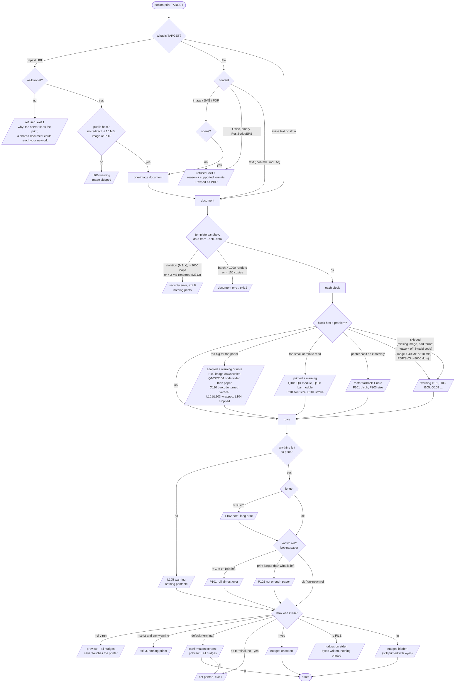

# When bobina warns, refuses or prints

One picture of the rule: **the command line decides, the content never grants itself anything**. A problem in a
document is a nudge and the rest prints; a target that cannot print at all is refused with the reason; security
problems always stop. Exit codes are in `docs/CLI.md`.

## Where a nudge is seen

| How it was run | Sees the nudges? | Prints? |
|---|---|---|
| `bobina print doc.bob.md` (terminal) | yes, on the confirmation screen, **before** printing | after `p` |
| `--dry-run` / `bobina check` / `bobina preview` | yes | never |
| `--yes` | yes, on stderr | yes |
| `--strict` | yes, and any warning stops it (exit 3) | only without warnings |
| `-q` | no (explicitly silenced) | yes |
| `--allow F301,L101` | not those codes | yes |

Security errors (`M3xx`, exit 8), oversized batches (exit 2) and refused targets (exit 1) cannot be silenced:
nothing prints. Paper nudges (`P101`, `P102`) appear only when the printer has a roll registered
(`bobina paper new`).

## Every problem, by stage

Generated by `tools/gen_problem_docs.py` from `src/bobina/nudges.py` (`bobina help nudges` lists the same).
Errors stop the job and nothing prints; warnings and notes never do (except with `--strict`). Evidence = the
printed test that measured the limit (`docs/printers/mtp-ii-58.md`). Every problem bobina reports has a code
from this list.

### Command line (errors: nothing prints)

| Code | Severity | Meaning | Evidence |
|---|---|---|---|
| `E101` | error | command line usage |  |
| `E102` | error | this command takes one document |  |
| `E103` | error | a job option was given twice with different values |  |
| `E104` | error | --then / --compact misuse |  |
| `E105` | error | --last / --again misuse, or nothing printed yet |  |
| `E106` | error | only one part can read stdin |  |
| `E107` | error | a terminal is needed (confirmation or --ask) |  |

### Input files and targets (errors)

| Code | Severity | Meaning | Evidence |
|---|---|---|---|
| `E201` | error | file not found or unreadable |  |
| `E202` | error | file type not supported as a target |  |
| `E203` | error | image, PDF page or page range not usable |  |
| `E204` | error | network target needs --allow-net |  |
| `E205` | error | nothing to print |  |
| `E206` | error | saved label (library) problem |  |
| `E207` | error | unknown template, profile, font or help topic |  |
| `E208` | error | output file problem (exists, format) |  |
| `E209` | error | a bobina state file is damaged or busy (counters, paper, library, config) |  |

### Data for batches (errors)

| Code | Severity | Meaning | Evidence |
|---|---|---|---|
| `E301` | error | data file unreadable or in an unsupported format |  |
| `E302` | error | no data rows (or none match --rows/--where) |  |
| `E303` | error | unknown column or sheet |  |
| `E304` | error | invalid value (--rows, --copies-from, --set, length) |  |
| `E305` | error | job too large (1000 labels, 100 copies) |  |

### Printer (errors)

| Code | Severity | Meaning | Evidence |
|---|---|---|---|
| `E401` | error | no printer configured or unknown printer |  |
| `E402` | error | printer unreachable |  |
| `E403` | error | printer not ready (paper, cover, error) |  |
| `E404` | error | retired: no longer reported |  |
| `E405` | error | printer busy: another bobina job kept it too long |  |
| `E406` | error | bobina init found no printer to set up |  |

### Document (errors)

| Code | Severity | Meaning | Evidence |
|---|---|---|---|
| `E501` | error | document error |  |

### Chat with an AI (errors)

| Code | Severity | Meaning | Evidence |
|---|---|---|---|
| `E601` | error | no AI found, or an unknown AI name |  |
| `E602` | error | the AI did not answer |  |

### Template and data (security: always stop)

| Code | Severity | Meaning | Evidence |
|---|---|---|---|
| `M310` | error | templates cannot read files |  |
| `M311` | error | unsafe template operation |  |
| `M312` | error | a variable cannot choose a file path |  |
| `M313` | error | template limit exceeded |  |
| `M314` | error | variables cannot be used inside raw blocks |  |
| `M315` | error | template path outside the allowed folders |  |

### Template and data (content)

| Code | Severity | Meaning | Evidence |
|---|---|---|---|
| `M101` | warning | unknown attribute |  |
| `M102` | note | unknown block type, printed as preformatted text |  |
| `M103` | note | attribute not implemented yet (ignored) |  |
| `M120` | note | field rendered as Markdown |  |
| `M121` | warning | raw block removed from a variable |  |
| `M122` | warning | image removed from a --data/--set value |  |
| `M130` | warning | undefined variable printed as empty |  |
| `M131` | warning | required template field is empty |  |
| `M140` | warning | counter passed its stop value |  |
| `M150` | warning | data rows without a match in the joined source |  |
| `M151` | warning | the joined source repeats a key (first row used) |  |
| `M152` | warning | a column exists in two sources; the bare name uses the main one |  |
| `M153` | warning | data values lost: extra fields in a row, or values under an empty header |  |
| `M154` | warning | the data header repeats a column name (the last one is used) |  |
| `M155` | note | a data source was renamed because a column has its name |  |
| `M156` | note | an option has no effect here (--sheet on a CSV, --repeat with --data) |  |
| `M157` | warning | --set replaces a data column of the same name in every row |  |
| `M158` | note | data columns renamed to names usable in {{ }} (Product Name → product_name) |  |
| `M159` | warning | two data columns would get the same usable name; the first keeps it |  |
| `M160` | note | Excel formula cells without a saved value print empty |  |
| `M201` | warning | date pattern looks like Moment.js |  |
| `M202` | warning | a value is not a number, or a date moved out of the calendar (printed as it is) |  |
| `M203` | note | this machine's locale, from its time zone, saved in config.toml (said once) |  |
| `M204` | note | no locale for this machine: dates, numbers and money in English |  |
| `M205` | warning | the document's locale: is not a locale bobina knows (the machine's is used) |  |

### Text and fonts

| Code | Severity | Meaning | Evidence |
|---|---|---|---|
| `F301` | note | glyph not in the printer font: line printed as an image | N5 |
| `F302` | warning | glyph missing in every available font |  |
| `F303` | note | size not supported natively, nearest native size used | N1 |
| `F304` | note | font for another script downloaded (once; used offline from then on) |  |
| `F305` | warning | font for this script not downloaded (off, or no network): letters print as boxes |  |
| `F306` | note | no font for the locale's script (none, or downloads off): English words, its formats |  |
| `F201` | warning | font below its tested minimum size | F1, F2 |
| `F202` | warning | untested font with strokes thinner than 2 dots | R4-01 |
| `F203` | warning | font not found, a bundled font was used |  |
| `F204` | warning | inverted raster text too thin or small | R2-12 |
| `F205` | warning | font size out of range (6 to 400 px), clamped |  |

### Layout and size

| Code | Severity | Meaning | Evidence |
|---|---|---|---|
| `L101` | warning | word longer than the line was split |  |
| `L102` | note | long print |  |
| `L103` | warning | preformatted line longer than the paper was wrapped |  |
| `L104` | warning | rotated block wider than the paper was cropped |  |
| `L105` | warning | nothing printable: every block was skipped |  |

### Codes (QR, barcodes, Pix)

| Code | Severity | Meaning | Evidence |
|---|---|---|---|
| `Q101` | warning | QR module too small to scan reliably | N6, R5-05 |
| `Q102` | warning | QR error correction L reads with difficulty | N6 |
| `Q103` | warning | QR wider than the paper |  |
| `Q104` | warning | barcode wider than the paper |  |
| `Q105` | note | barcode preview is approximate (no encoder for this type) |  |
| `Q106` | warning | barcode type not supported by this printer | N6 |
| `Q107` | warning | barcode type prints but phones struggle to read it | N6 |
| `Q108` | warning | barcode module too thin to scan | N6 |
| `Q109` | warning | invalid barcode content |  |
| `Q110` | warning | barcode turned vertical to fit the paper |  |
| `Q111` | warning | payment code not built: an attribute is missing or invalid (the code is left out, the rest prints, exit 9) |  |

### Images

| Code | Severity | Meaning | Evidence |
|---|---|---|---|
| `I101` | warning | image not found or unreadable |  |
| `I102` | note | image downscaled to the paper width |  |
| `I103` | warning | network image skipped: fetching reveals the print and could reach your network |  |
| `I104` | note | image fetched from the network |  |
| `I105` | warning | PDF/SVG support not installed |  |
| `I107` | warning | image path with a space must be written between < > |  |
| `I106` | warning | network source refused (private address, redirect, type or size) |  |
| `I108` | warning | image outside the document folder and image_dirs (--sandbox, MCP) |  |

### Drawing

| Code | Severity | Meaning | Evidence |
|---|---|---|---|
| `B101` | warning | stroke thinner than 2 dots prints broken | R4-01 |
| `B102` | note | free rotation angles look jagged |  |

### Paper and printer

| Code | Severity | Meaning | Evidence |
|---|---|---|---|
| `P101` | warning | the paper roll is almost over (estimate) |  |
| `P102` | warning | the print is longer than the paper left on the roll (estimate) |  |
| `P103` | warning | the roll is not as wide as this printer's paper (recorded anyway) |  |
| `P104` | note | the roll length is not set: no estimate of the paper left |  |
| `P105` | note | --compact: the labels print at once, glued, without stopping between them |  |
| `P106` | note | --step: no terminal to wait on, so every label prints at once |  |
| `P301` | note | this job uses a feature not tested on paper yet |  |
| `P302` | note | a payment code nobody has scanned with its app yet |  |
| `P201` | warning | raw bytes bypass every check and are not previewed |  |
| `P401` | note | Bluetooth or USB printers cannot be looked for on this machine (the message says why) |  |
| `P402` | note | the printer's name does not settle the profile (no match, or several widths): one was taken |  |
| `P403` | warning | a USB printer this user cannot write to |  |
| `P404` | warning | a printer in config.toml names a profile bobina does not know |  |
