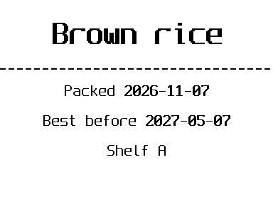
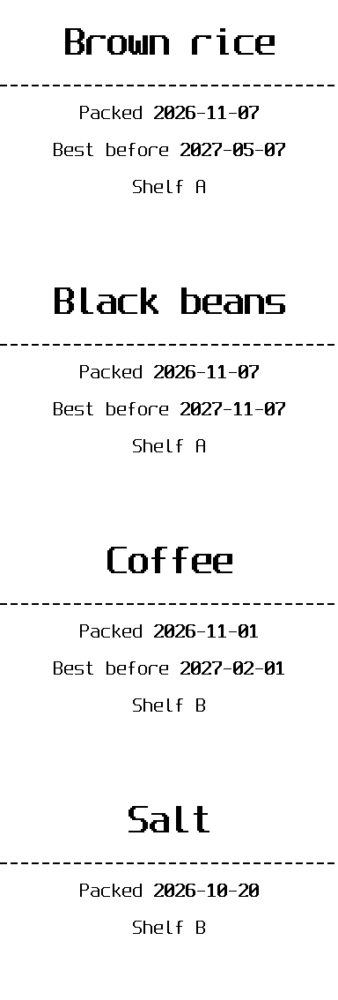
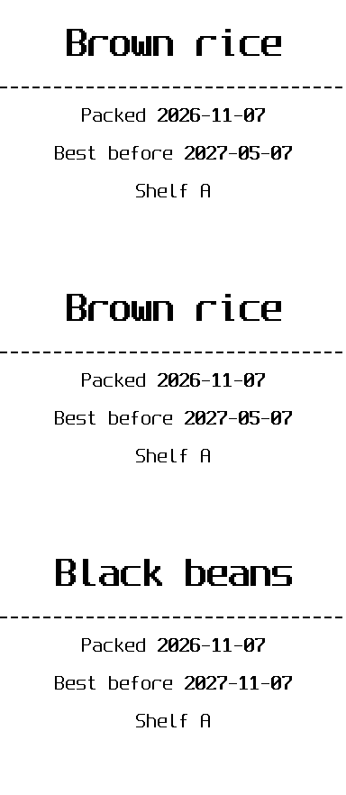

# Printing a batch: one label per row

You have **one label design** and **a list of things** to label: jars in the pantry, guests at a party, products
on a shelf, kids' school notebooks. Instead of editing and printing the label once per item, you write the design
once with blanks, put the list in a table, and bobina prints one label per row.

```
  the design (with blanks)          the list (one row per label)          what prints
 ┌──────────────────────┐     ┌─────────────┬────────────┬───────┐     ┌──────────────┐
 │   {{ product }}      │     │ product     │ packed     │ shelf │     │  Brown rice  │
 │ - - - - - - - - - -  │  +  ├─────────────┼────────────┼───────┤  =  │  Packed …  A │
 │ Packed {{ packed }}  │     │ Brown rice  │ 2026-11-07 │ A     │     ├──────────────┤
 │ Shelf {{ shelf }}    │     │ Black beans │ 2026-11-07 │ A     │     │ Black beans  │
 └──────────────────────┘     │ Coffee      │ 2026-11-01 │ B     │     │  Packed …  A │
                              └─────────────┴────────────┴───────┘     ├──────────────┤
                                                                       │    Coffee    │
                                                                       └──────────────┘
```

The **column names of the table are the names of the blanks**. That is the whole idea. The files of this guide
are in [`examples/batch/`](../../examples/batch/): run the commands from that folder.

## 1. The design, with blanks

`jar-label.bob.md` is an ordinary bobina document. Each `{{ name }}` is a blank:

```markdown
---
fields:
  product: { required: true, example: "Brown rice" }
  packed:  { help: "date the jar was filled (YYYY-MM-DD)" }
  best_before: { help: "YYYY-MM-DD; leave empty if it does not expire" }
  shelf:   { example: "A" }
---
# {{ product }} {.center}

--- {.dashed}

Packed **{{ packed }}** {.center}


Best before **{{ best_before }}** {.center}


Shelf {{ shelf }} {.center}
```

The `fields:` list at the top is optional. It documents the blanks (`bobina template show`), marks the
required ones, and lets `--ask` ask for them. `` skips that line when the value is empty.

**Try it with one label first**, filling the blanks by hand:

```sh
bobina preview jar-label.bob.md --set product="Brown rice" --set packed=2026-11-07 \
  --set best_before=2027-05-07 --set shelf=A -o one.png
```



Or let bobina ask: `bobina print jar-label.bob.md --ask`.

## 2. The list, as a table

The same list in three formats. Use whichever you already have; bobina reads them all with `--data`.

**A spreadsheet** (`pantry.xlsx`, first sheet, or `--sheet Pantry`): the first filled row is the header.

| product | packed | best_before | shelf | jars |
|---|---|---|---|---|
| Brown rice | 2026-11-07 | 2027-05-07 | A | 2 |
| Black beans | 2026-11-07 | 2027-11-07 | A | 1 |
| Coffee | 2026-11-01 | 2027-02-01 | B | 1 |
| Salt | 2026-10-20 | | B | 0 |

**CSV** (`pantry.csv`), what a spreadsheet saves with "Save as CSV". Commas, semicolons, tabs or `|` all work:

```csv
product,packed,best_before,shelf,jars
Brown rice,2026-11-07,2027-05-07,A,2
Black beans,2026-11-07,2027-11-07,A,1
Coffee,2026-11-01,2027-02-01,B,1
Salt,2026-10-20,,B,0
```

**JSON** (`pantry.json`), what a program or a web service usually gives you: a list of objects, one per label,
with the blank names as keys.

```json
[
  { "product": "Brown rice",  "packed": "2026-11-07", "best_before": "2027-05-07", "shelf": "A", "jars": 2 },
  { "product": "Black beans", "packed": "2026-11-07", "best_before": "2027-11-07", "shelf": "A", "jars": 1 },
  { "product": "Coffee",      "packed": "2026-11-01", "best_before": "2027-02-01", "shelf": "B", "jars": 1 },
  { "product": "Salt",        "packed": "2026-10-20", "best_before": "",           "shelf": "B", "jars": 0 }
]
```

Columns that the design does not use (here `jars`) are simply ignored, unless you use them for copies (step 4).

## 3. Preview the whole batch, then print

```sh
bobina preview jar-label.bob.md --data pantry.csv -o all.png   # look first
bobina print   jar-label.bob.md --data pantry.csv              # confirmation screen, then p
```



Four rows, four labels, one print job. Salt has no `best_before`, so that line is not printed.

## 4. Only some rows, and copies per row

| You want | Add | With this list |
|---|---|---|
| only rows 2 to 3 | `--rows 2-3` | Black beans, Coffee |
| only shelf A | `--where shelf=A` | Brown rice, Black beans |
| everything except salt | `--where product!=salt` | the first three |
| names containing "rice" | `--where product~=rice` | Brown rice |
| as many labels as jars | `--copies-from jars` | rice ×2, beans ×1, coffee ×1, salt skipped (0) |

Filters combine. Shelf A, one label per jar:

```sh
bobina print jar-label.bob.md --data pantry.json --where shelf=A --copies-from jars
```



`--rows` counts data rows (1 is the first row after the header) and is applied before `--where`. Matching ignores
upper/lower case. A column name that does not exist stops with the list of columns that do.

## 5. Two sources for one label (`--join`)

Sometimes the label needs columns from two places: prices in a spreadsheet, the catalog (category, id) in a
JSON exported by another system. Name the sources and say which column matches them:

```sh
bobina print shelf-tag.bob.md --data a=prices.xlsx --join b=catalog.json --on name
```

| `prices.xlsx` (a) | | | | `catalog.json` (b) | | |
|---|---|---|---|---|---|---|
| name | price | size | category | name | category | id |
| Rice | 12.5 | 1kg | grains | rice | grocery | 101 |
| Salt | 3 | 1kg | spice | | | |

In the design, a column without a prefix works when only one source has it; the prefix picks one when both do:

```markdown
{{ name }} — {{ price }} ({{ size }})       ← name is the key; price and size only exist in a
{{ id }}                                    ← only in b
{{ a.category }} / {{ b.category }}   ← both have it: the prefix chooses
```

- `--data` is the **main** source: one label per row. `--join` adds the columns of the row with the same key
  (matching ignores upper/lower case). Without a name, a source is called after its file (`catalog.json` →
  `{{ catalog.id }}`).
- Different key names: `--on name=product`. Several joins: each `--on` belongs to the `--join` before it
  (`--join b=catalog.json --on name --join stock.csv --on b.id=id`).
- Rows without a match print with the joined fields empty, and one warning lists them (`M150`); guard what
  surrounds a joined field so it does not dangle: ` / {{ b.category }}`. A key repeated
  in the joined source uses its first row (`M151`); `{{ category }}` in both sources uses the main one and says
  so (`M152`). `--where`, `--rows` and `--copies-from` work after the join, also on joined columns
  (`--where b.category=grocery`).
- Values from every source are printed literally, and only the command line chooses the files.

## Column names

A blank in the design is written like a variable: letters, digits and `_`. Headers that are not written that way
get a usable name automatically (and a note lists them): `Product Name` → `product_name`, `Preço` → `preco`,
`Data de Validade` → `data_de_validade`. The exact header always works too: `{{ row['Product Name'] }}`. If two
headers would get the same name, the first keeps it and a warning says so (`M159`).

## Good to know

- **Values are printed exactly as written.** A product called `**NEW** {{ x }}` prints those characters; data
  never becomes formatting, template code or printer commands. Only the design decides the layout.
- **Empty values**: a blank with no value prints empty (`M130`); a required one gives `M131` with the data row
  (`data row 3: required field 'product' is empty`). `--strict` stops the job instead.
- **`--set` and a column with the same name**: `--set` wins in every row (`M157`), handy to fix one field for
  the whole batch. `--where`, `--rows`, `--copies-from` and `--sheet` need `--data`; two `--data` in one part is
  an error (use `--then` to print both lists, `--join` to combine them). Both are warnings
  on the confirmation screen; nothing is blocked.
- **Counters** (`{{ seq.jar }}`) advance once per row; copies of a row repeat its number.
- **Spreadsheets**: formulas are not recalculated; the value Excel saved is used. `.xls`/`.ods` must be saved as
  `.xlsx` or `.csv`. Dates come out as `YYYY-MM-DD` (format them in the design with `{{ packed | date }}`).
- **Paper**: each label ends with the feed to the tear bar. Add `--compact` to print the batch as one strip with
  ✂ lines between labels and one feed at the end; `--then other.bob.md` adds more to the same strip.
- **Limits**: 1000 labels per job, copies included (`--copies`, `--copies-from`, `--repeat`, every `--then` part),
  and at most 100 copies of one label. Split bigger lists with `--rows`. `--copies` and `--copies-from` multiply.
- **Saved designs**: `bobina library add jar jar-label.bob.md`, then `bobina print @jar --data pantry.csv`.

## Other ideas

| Design | List |
|---|---|
| name badge (`{{ name }}`, `{{ company }}`) | the guest list exported from a form |
| shipping label (`{{ name }}`, `{{ address }}`, a QR with `{{ tracking }}`) | the day's orders as CSV |
| price tag (`{{ product }}`, `{{ price | currency('BRL') }}`, a barcode with `{{ ean }}`) | the price spreadsheet |
| school labels (`{{ child }}`, `{{ subject }}`) | one row per notebook, `--copies-from` for spares |
