# Icons on labels

<!-- generated by tools/gen_icon_docs.py from src/bobina/icons/catalog.py: do not edit by hand -->

Write `:name:` anywhere in a document and bobina prints the symbol: `:fragile: Glasses`. Alone on a line,
with `{size=3x .center}`, it is a big mark. Many people do not know what each symbol means, so each one is
explained below. In the terminal: `bobina help icons`.

- An icon is two columns wide and drawn as an image (a line with one prints a little slower). Symbols
  with numbers or dots (wash temperatures) read best at `{size=2x}` or larger.
- `` `:fragile:` `` (code) and `\:fragile:` print the word; so does a `:name:` that comes from `--data` or
  `--set` (data is always literal). An unknown name prints as written, with `M161` and the closest names.

The care symbols (wash, airing, bleach, ironing, dry cleaning) are trademarks of GINETEX in several countries: printing them for your own things is fine; using them on garments you sell may need a licence where you sell.

## Wash

The tub: how to wash; the number is the highest water temperature.

| | Write | Means |
|---|---|---|
|  | `:wash:` | machine wash, normal cycle |
|  | `:wash-30:` | wash at up to 30 °C, normal cycle |
|  | `:wash-40:` | wash at up to 40 °C, normal cycle |
|  | `:wash-60:` | wash at up to 60 °C, normal cycle |
|  | `:wash-95:` | wash at up to 95 °C, normal cycle (whites, cotton) |
|  | `:wash-30-gentle:` | up to 30 °C, gentle cycle (one line under the tub: less spinning) |
|  | `:wash-40-gentle:` | up to 40 °C, gentle cycle |
|  | `:wash-30-very-gentle:` | up to 30 °C, very gentle cycle (two lines: wool, silk) |
|  | `:wash-hand:` | hand wash only, lukewarm water |
|  | `:no-wash:` | do not wash |

## Airing (drying)

The square: how to dry; a circle in it is the tumble dryer.

| | Write | Means |
|---|---|---|
|  | `:dry-tumble:` | tumble dry |
|  | `:dry-tumble-low:` | tumble dry at low heat (one dot) |
|  | `:dry-tumble-high:` | tumble dry at normal heat (two dots) |
|  | `:no-tumble:` | do not tumble dry |
|  | `:dry-line:` | dry on a line |
|  | `:dry-flat:` | dry flat (lay it on a surface) |
|  | `:dry-drip:` | drip dry: hang it wet, do not wring |
|  | `:dry-shade:` | dry in the shade |

## Bleach

The triangle.

| | Write | Means |
|---|---|---|
| 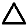 | `:bleach:` | any bleach |
| 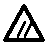 | `:bleach-non-chlorine:` | only oxygen (non-chlorine) bleach |
|  | `:no-bleach:` | do not bleach |

## Ironing

The iron: the dots are the heat.

| | Write | Means |
|---|---|---|
|  | `:iron:` | iron |
|  | `:iron-low:` | iron at low heat, up to 110 °C (synthetics) |
|  | `:iron-medium:` | iron at medium heat, up to 150 °C (wool, polyester) |
|  | `:iron-high:` | iron at high heat, up to 200 °C (cotton, linen) |
| 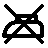 | `:no-iron:` | do not iron |

## Dry cleaning

The circle: for the professional cleaner.

| | Write | Means |
|---|---|---|
|  | `:dry-clean:` | professional dry clean |
|  | `:dry-clean-p:` | professional dry clean with the usual solvents (P) |
|  | `:dry-clean-f:` | professional dry clean with mild solvents only (F) |
| 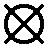 | `:no-dry-clean:` | do not dry clean |

## Packing

On boxes and parcels: how to handle them.

| | Write | Means |
|---|---|---|
|  | `:fragile:` | fragile: breaks easily |
|  | `:this-side-up:` | this side up: keep the arrows pointing up |
|  | `:keep-dry:` | keep dry: away from rain and water |
|  | `:handle-with-care:` | handle with care |
|  | `:do-not-stack:` | do not stack anything on it |
|  | `:keep-away-from-heat:` | keep away from heat and sunlight |
|  | `:recycle:` | recycle the packaging |

## Attestation

Marks a product carries; print them only when your product meets them.

| | Write | Means |
|---|---|---|
|  | `:ce:` | CE: the maker declares it meets EU product rules |
|  | `:ukca:` | UKCA: the same for Great Britain |
|  | `:e-mark:` | ℮: the quantity is an average (EU prepacked goods) |
|  | `:recycle:` | recyclable |

## Home goods

Kitchen, food, bathroom and office.

| | Write | Means |
|---|---|---|
|  | `:cooking-pot:` | cooking pot |
|  | `:soup:` | soup |
|  | `:salad:` | salad |
|  | `:sandwich:` | sandwich |
| 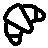 | `:croissant:` | bread, bakery |
|  | `:cake:` | cake |
|  | `:cookie:` | cookie |
|  | `:pizza:` | pizza |
|  | `:apple:` | fruit |
|  | `:banana:` | banana |
| 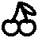 | `:cherry:` | cherry |
|  | `:grape:` | grapes |
|  | `:citrus:` | citrus |
|  | `:carrot:` | vegetables |
|  | `:bean:` | beans |
|  | `:wheat:` | contains gluten (wheat) |
| 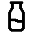 | `:milk:` | contains milk |
| 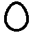 | `:egg:` | contains egg |
|  | `:nut:` | contains nuts |
| 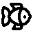 | `:fish:` | fish |
|  | `:drumstick:` | chicken |
|  | `:beef:` | meat |
|  | `:ham:` | ham, pork |
|  | `:popcorn:` | popcorn |
| 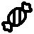 | `:candy:` | sweets |
|  | `:lollipop:` | lollipop |
| 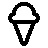 | `:ice-cream-cone:` | ice cream |
|  | `:coffee:` | coffee |
| 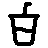 | `:cup-soda:` | soft drink |
|  | `:glass-water:` | water |
|  | `:wine:` | wine |
|  | `:beer:` | beer |
| 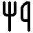 | `:utensils:` | food, meal |
|  | `:snowflake:` | freezer, keep frozen |
| 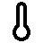 | `:thermometer:` | temperature |
|  | `:refrigerator:` | fridge |
|  | `:microwave:` | microwave |
|  | `:flame:` | hot, cooking |
|  | `:washing-machine:` | washing machine |
|  | `:bath:` | bathroom |
|  | `:shower-head:` | shower |
|  | `:toilet:` | toilet |
| 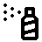 | `:spray-can:` | cleaning spray |
|  | `:bed-double:` | bedroom |
|  | `:sofa:` | living room |
|  | `:lamp:` | lamp |
|  | `:shirt:` | clothes |
|  | `:pen:` | pen |
|  | `:pencil:` | pencil |
|  | `:paperclip:` | clips |
|  | `:file-text:` | documents |
|  | `:folder:` | folder |
|  | `:printer:` | printer |
|  | `:book:` | book |
|  | `:briefcase:` | work |
|  | `:calculator:` | calculator |
|  | `:ruler:` | ruler |
| 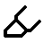 | `:highlighter:` | highlighter |
|  | `:scissors:` | scissors |

## General

Everyday marks.

| | Write | Means |
|---|---|---|
|  | `:check:` | yes, done |
|  | `:x:` | no |
|  | `:heart:` | love, favourite |
|  | `:star:` | star, highlight |
|  | `:info:` | information |
|  | `:triangle-alert:` | warning |
|  | `:ban:` | not allowed |
|  | `:bell:` | reminder |
|  | `:bookmark:` | bookmark |
|  | `:tag:` | price, sale |
|  | `:gift:` | gift |
|  | `:clock:` | time |
|  | `:calendar:` | date |
|  | `:phone:` | phone |
|  | `:mail:` | e-mail |
|  | `:map-pin:` | place, address |
|  | `:house:` | home |
|  | `:truck:` | delivery |
|  | `:package:` | parcel |
| 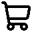 | `:shopping-cart:` | shopping |
|  | `:key:` | key |
|  | `:lock:` | locked, private |
|  | `:sun:` | sun, day |
|  | `:moon:` | night |
| 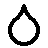 | `:droplet:` | water |
|  | `:umbrella:` | rain |
|  | `:leaf:` | plant, natural |
|  | `:trash-2:` | rubbish |
|  | `:zap:` | electricity |
|  | `:wifi:` | wi-fi |
|  | `:music:` | music |
|  | `:baby:` | baby |
|  | `:dog:` | dog |
|  | `:cat:` | cat |
|  | `:pill:` | medicine |
|  | `:bike:` | bike |
|  | `:car:` | car |
|  | `:plane:` | travel |
|  | `:hand:` | hand, stop |
|  | `:hand-heart:` | care, kindness |
|  | `:smile:` | smile |
|  | `:thumbs-up:` | good, like |

## Use cases

### Care label for clothes you sew or sell

The washing instructions, in the order a label shows them.

```markdown
**Cotton dress** {.center}

:wash-30-gentle: :no-bleach: :dry-flat: :iron-medium: :no-dry-clean: {size=2x .center}

Wash inside out {.center}
```

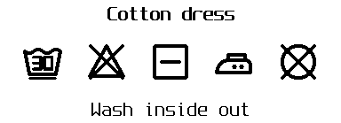

### Kids' school clothes

A name tag and how to wash it, small enough for a collar.

```markdown
**Ana · 3rd grade** {.center}

:wash-40: :no-tumble: :iron-low: {size=2x .center}
```


### Moving boxes

What is inside and how to carry it.

```markdown
# KITCHEN {.center}

Glasses, plates {.center}

:fragile: :this-side-up: :do-not-stack: {size=3x .center}
```

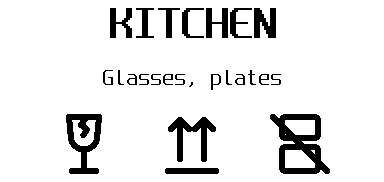

### Pantry and freezer

What it is, when it was made, what it contains.

```markdown
**Bean soup** {.center}

:snowflake: frozen 2026-11-13 {.center}

:wheat: gluten · :milk: milk {.center}
```

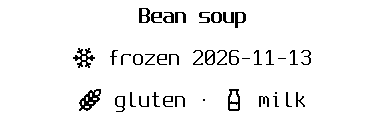

### Shipping a fragile parcel

The marks a carrier looks for, big.

```markdown
:fragile: :keep-dry: :handle-with-care: {size=3x .center}

**FRAGILE** {.center size=2x}
```

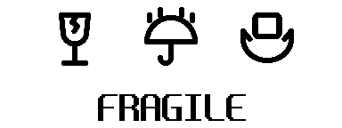
