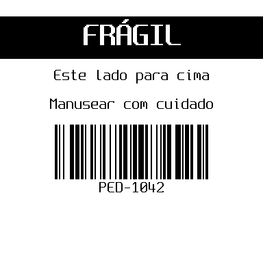
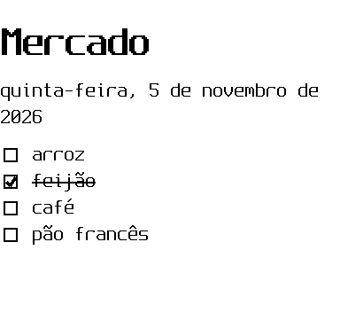
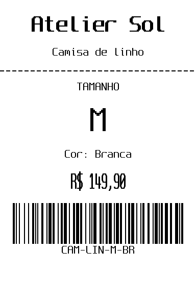
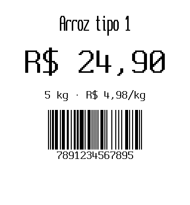
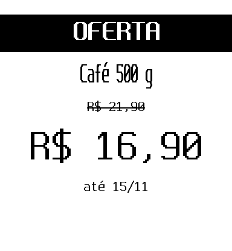
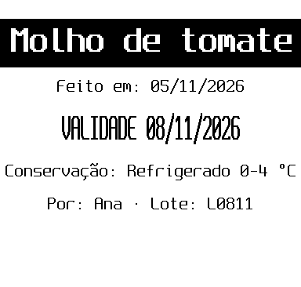
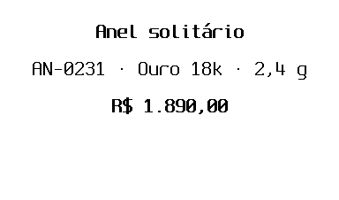
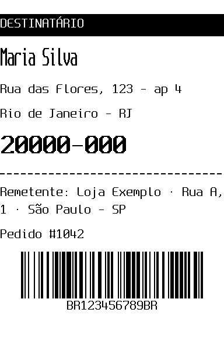
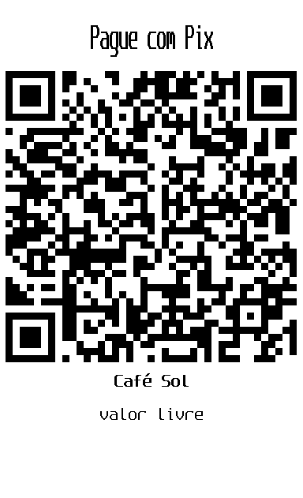

# Ready-made templates: recipes and gallery

A template is a document with blanks that ships with bobina. You give it the values; it does the layout. Every
template below prints on a 58 mm roll with no warning.

```bash
bobina template list                          # every template and its fields
bobina template show label                    # one template: fields, required, examples
bobina template new label box.bob.md          # a starter file with every field, marked required / optional
bobina preview box.bob.md -o box.png          # look before printing
bobina print box.bob.md                       # confirmation screen, then paper
```

A document uses a template with `template: NAME` in its front matter; **the other keys are the fields**. A field
can also come from `--set NAME=VALUE`, `--ask` (asked on the terminal) or a column of `--data` (one label per row,
see [batch-printing.md](batch-printing.md)). `locale: pt-BR` switches the template's fixed words and the date
format to Portuguese. The full rules are in [FORMAT.md §8](../FORMAT.md).

## Recipe: a box label (`label`)

A big inverted title, lines under it and an optional Code 128 or QR code: a box, a shelf, a jar.

```markdown
---
template: label
locale: pt-BR
title: "FRÁGIL"
lines: ["Este lado para cima", "Manusear com cuidado"]
barcode: "PED-1042"
---
```



- `title` is required; `lines` is a list (one centred line each); `qr` instead of `barcode` for a link or a
  Pix key.
- One label per item of a list: keep the design, move the values to a CSV and print with `--data items.csv`.

## Recipe: a card (`card`)

A title between wavy rules, a message that may use Markdown (`**bold**`), a signature on the right.

```markdown
---
template: card
locale: pt-BR
title: "Feliz aniversário!"
message: "Que o seu ano seja **leve** e cheio de boas notícias."
from: "Ana e Pedro"
---
```


- `title` and `message` are required; without `from` there is no signature line.
- From the terminal, without a file: `bobina edit --template card` opens a draft in your editor.

## Recipe: a to-do list (`todo`)

A heading, today's date written out, one checkbox per item. An item that starts with `x ` is printed done.

```markdown
---
template: todo
locale: pt-BR
title: "Mercado"
items: ["arroz", "x feijão", "café", "pão francês"]
---
```



- `items` is required; `title` defaults to "To do" ("Tarefas" in Portuguese); `date` defaults to today, so a
  list printed on Monday says Monday.
- Leave `items` out of the file and pass `--ask`: bobina asks for the items on the terminal.

## Gallery: one template per kind of shop

Each one is a small document in [`examples/templates/`](../../examples/templates/), printed here as it comes out of
the printer. Copy one, change the values, print.

| Shop | Template | What it has | Preview |
|---|---|---|---|
| Clothing | `clothing-tag` | brand, piece, size and colour, price, SKU as Code 128 |  |
| Grocery | `shelf-price` | product, a huge price, price per kg or L, EAN-13 |  |
| Grocery | `sale-price` | an inverted SALE band, the old price struck through, the new price |  |
| Kitchen | `food-label` | product inverted, made today, use by today + `days` (default 3), storage, who, batch |  |
| Jewellery | `jewelry-tag` | piece, code, metal and weight, price; short lines for a narrow strip |  |
| Online shop | `shipping-label` | recipient and address in large type, sender, order, tracking as Code 128 |  |
| Any counter | `pay-sign` | "Pay with …" and a big payment code for any scheme (Pix, UPI, SEPA…), the name, the amount or "any amount" |  |

- A price can be typed `24.90`, `24,90` or `R$ 1.890,00`; the template writes it in the currency of `currency`
  (default `BRL`, `R$ 24,90` in Portuguese). A price that is not a number (`consulte`) or is ambiguous
  (`1234.567`) prints as typed, with `M202`. A `days` the food label cannot count (`uma semana`) counts as 0, so
  the use-by date is today, also with `M202`: look at the warning before printing.
- `food-label` computes both dates when it prints: the same file printed tomorrow says tomorrow. Print a batch
  on the day it is made; `print --last` reprints the identical bytes, old dates included.
- Price tags for a whole shelf come from a spreadsheet: `bobina print shelf-price.bob.md --data prices.xlsx`,
  one column per field.

## Your own templates

A template is a `.bob.md` with a `fields:` front matter (FORMAT.md §8). Put it in `~/.config/bobina/templates/`
and `template: my-price` finds it; one with the same name as a built-in one wins over it. A `.bob.md` path next
to the document works too (`template: tags/price.bob.md`). The built-in ones are in
[`src/bobina/templates/`](../../src/bobina/templates/): copy one and change its layout. `bobina template list`
shows only the built-in ones.
